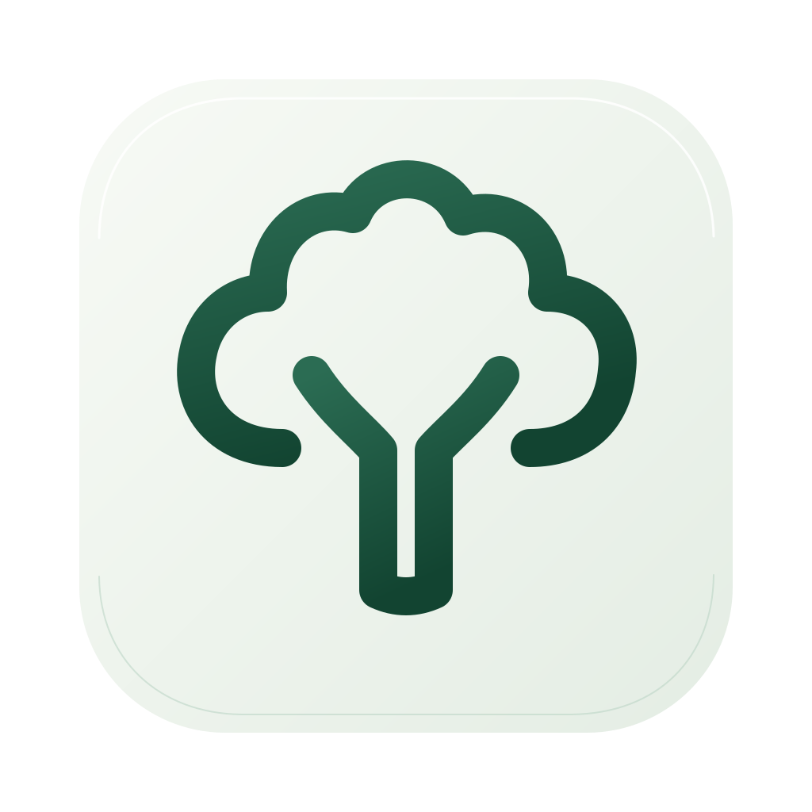
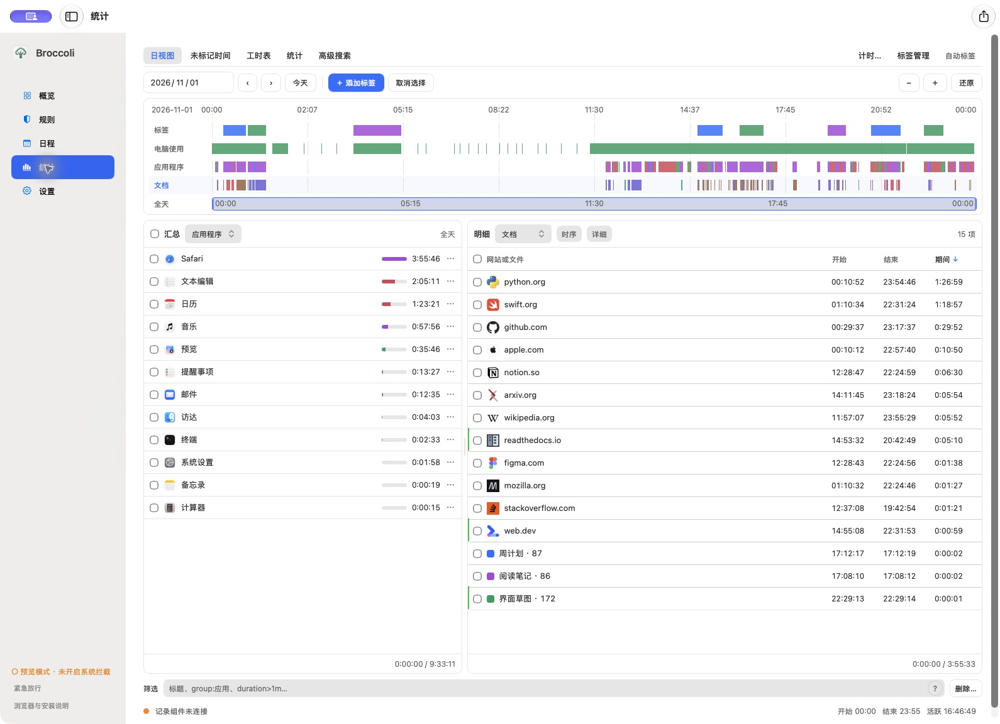
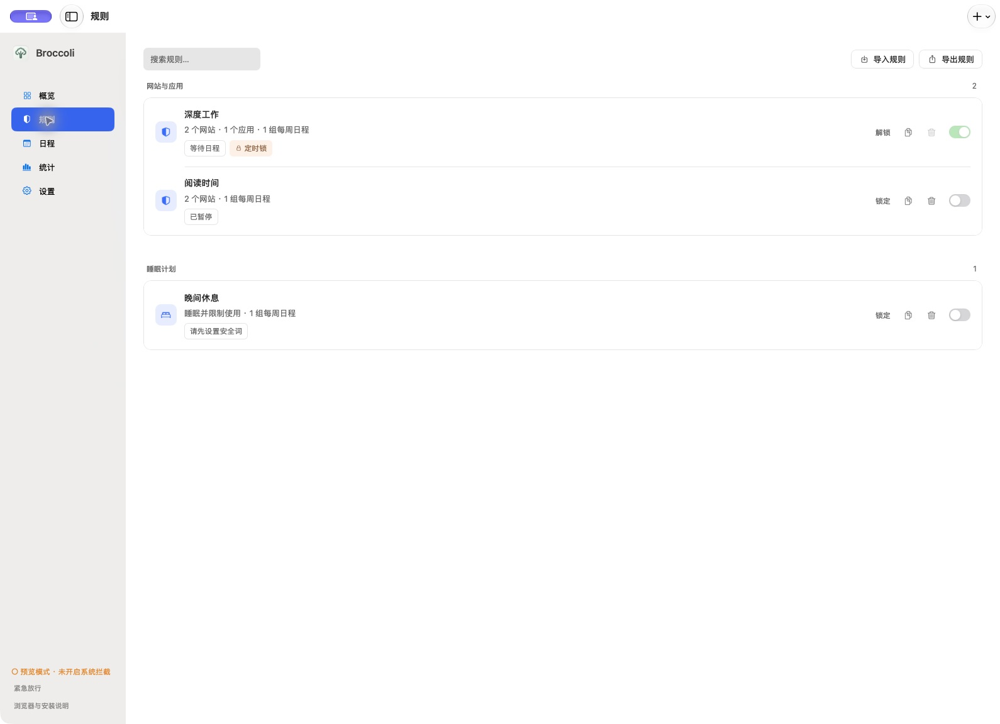
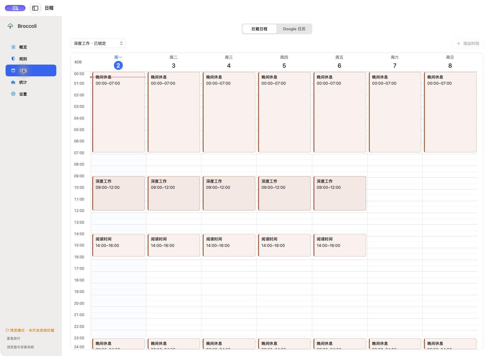
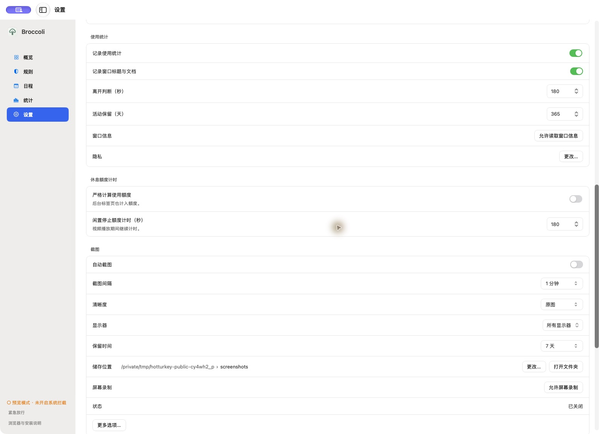

# Broccoli

[中文](README.md) · [Download](https://github.com/ykorb1337/Broccoli/releases)



A native macOS app for focus, time tracking, and calendar planning.



- **Focus rules** — block websites and apps, schedule sessions, and add distractions while a rule is locked.
- **Calendar** — weekly focus schedules and an independent Google Calendar viewer and editor.
- **Activity** — interactive timelines, filters, tags, and date-range exports.
- **Screenshots** — optional local capture, hover previews, and original-image viewing.
- **Device limits** — scheduled breaks with a recovery word.

## A closer look





Demo screenshots are anonymized. Data stays on your Mac; Google Calendar is an optional connection.

## Install

1. Download the latest `.dmg` from [Releases](https://github.com/ykorb1337/Broccoli/releases).
2. Open **Broccoli Installer** and choose **Install**.
3. Open Broccoli. For website blocking, follow the browser-extension setup in the app.

Apple Silicon · macOS 12 or later. Preview builds are ad-hoc signed and are not yet notarized by Apple. See [installation details](docs/INSTALLATION.md).

**Uninstall:** download **Broccoli Uninstaller** separately from the release. It is not included in, downloaded by, or linked from the main app or installer. Local data is preserved. The tool can itself be blocked by an app rule or the installer-blocking setting.

## Build

Requires macOS, Python 3.9+, and Apple Command Line Tools:

```sh
python3 scripts/build.py --distribution
```

The app and setup tools include their Python runtime. [Development](docs/DEVELOPMENT.md) · [Google Calendar](docs/GOOGLE-CALENDAR.md) · [Security](SECURITY.md) · [Contributing](CONTRIBUTING.md)

MIT license. Runtime and dependency notices are included with the download.
