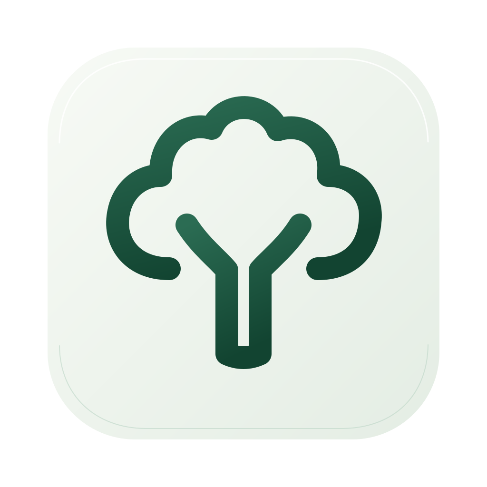
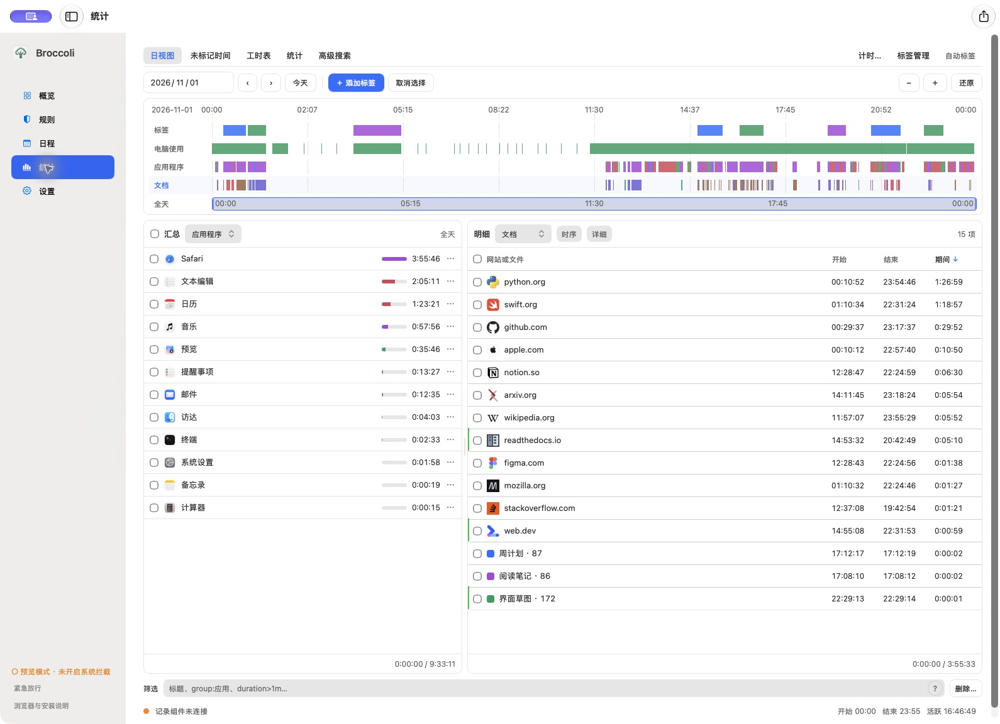
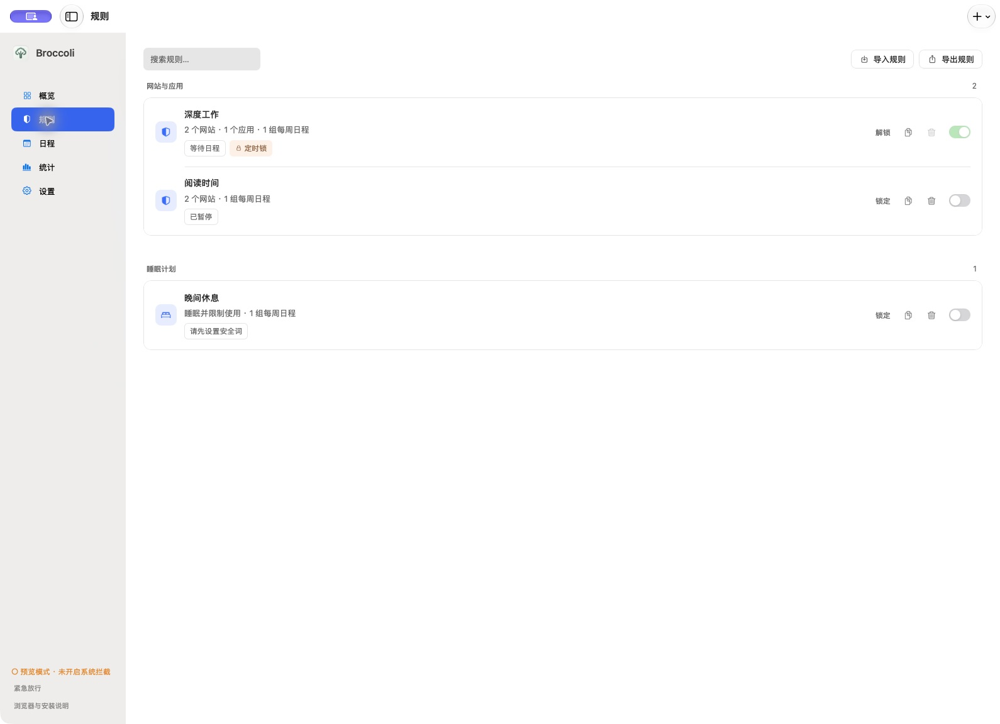
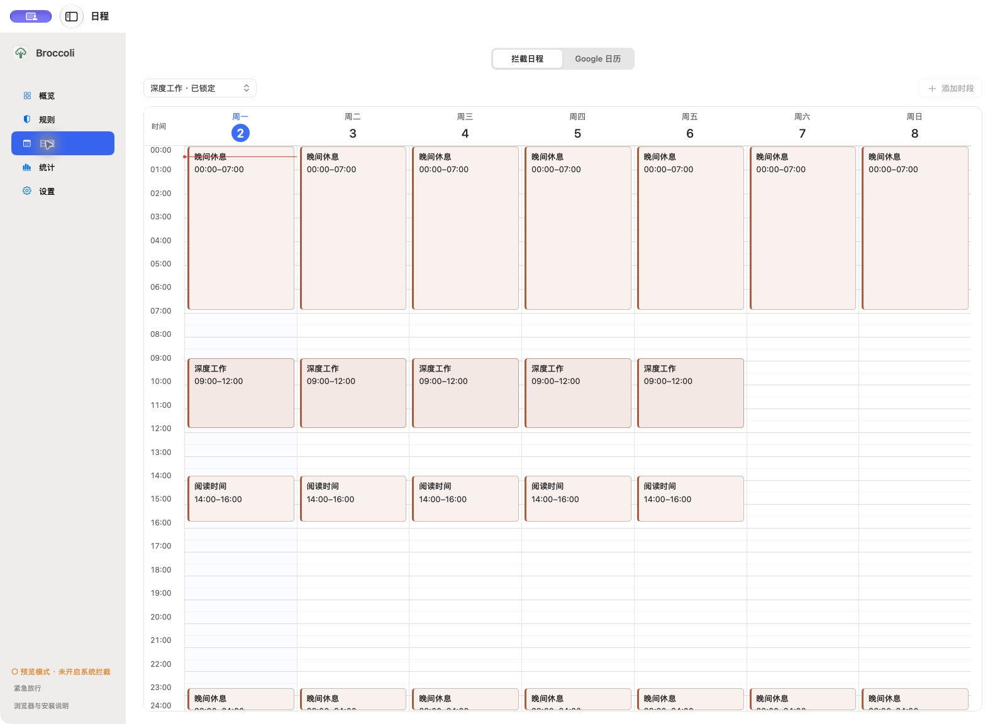
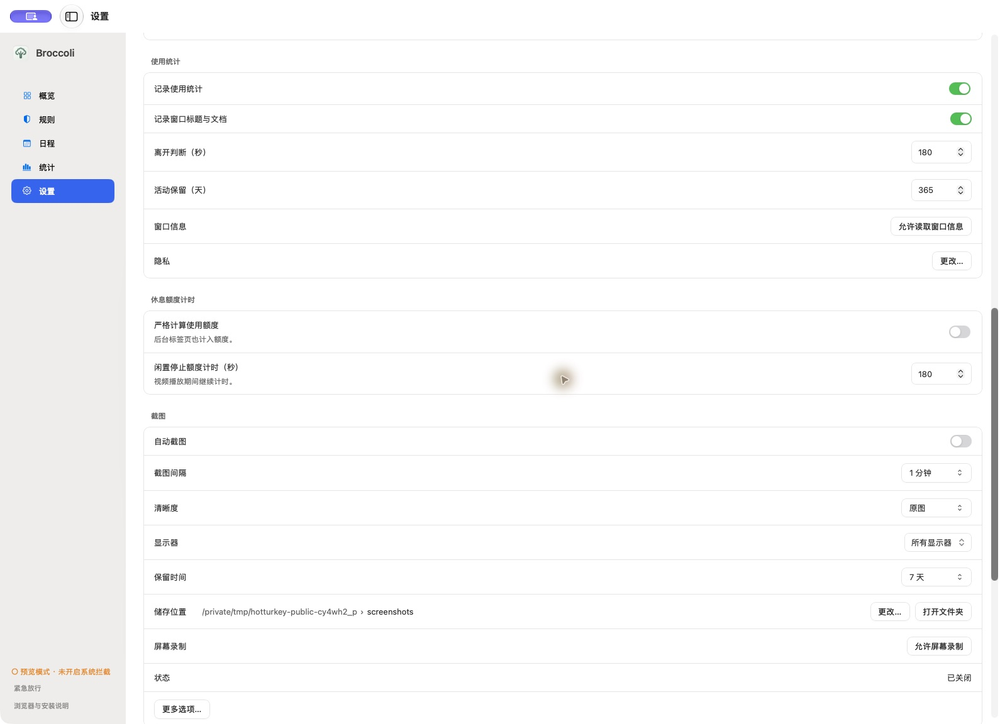

# Broccoli

[English](README.en.md) · [下载](https://github.com/ykorb1337/Broccoli/releases)



一款原生 macOS 专注、时间记录与日程管理工具。



- **专注规则**：拦截网站与应用，设置每周计划；锁定后仍可追加拦截目标。
- **日程管理**：每周专注日程，以及独立的 Google 日历查看与编辑。
- **使用统计**：交互时间轴、筛选、标签与日期区间导出。
- **截图记录**：可选的本地截图、悬浮预览与原图查看。
- **设备限制**：定时休息，并通过安全词恢复使用。

## 界面





演示截图已匿名化。数据保存在本机，Google 日历为可选连接。

## 安装

1. 在 [Releases](https://github.com/ykorb1337/Broccoli/releases) 下载最新 `.dmg`。
2. 打开 **Broccoli Installer**，点击“安装”。
3. 打开 Broccoli；网站拦截的扩展配置见应用内安装说明。

支持 Apple Silicon、macOS 12 及以上。当前为预览版，使用本地签名，尚未通过 Apple 公证。[安装详情](docs/INSTALLATION.md)

**卸载**：在发行版中单独下载 **Broccoli Uninstaller**。主应用与安装器不包含、不自动下载，也不提供卸载器下载入口。卸载保留本地数据；卸载器自身可被应用规则或“拦截安装器”设置拦截。

## 构建

需要 macOS、Python 3.9+ 与 Apple Command Line Tools：

```sh
python3 scripts/build.py --distribution
```

应用与安装工具均自带 Python 运行时。[开发说明](docs/DEVELOPMENT.md) · [Google 日历](docs/GOOGLE-CALENDAR.md) · [安全](SECURITY.md) · [参与贡献](CONTRIBUTING.md)

MIT 许可。运行时与依赖的许可说明随安装包提供。
